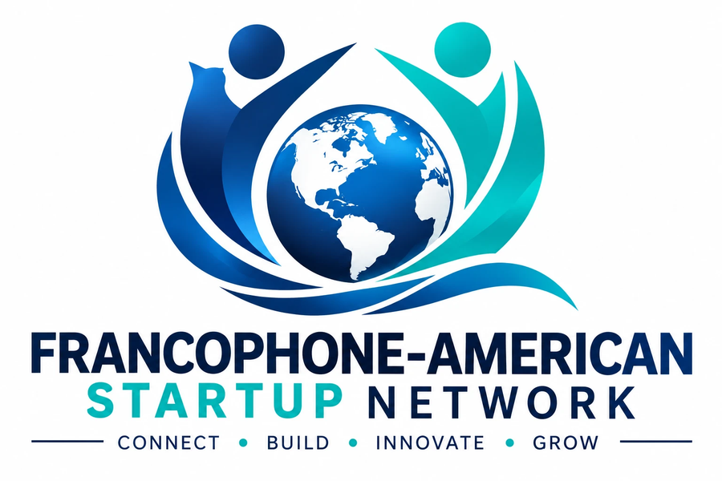

<p align="center">
  
</p>

# Francophone-American Startup Network (FASN)

**Your Business. Your Network. Your Opportunity.** · *Votre entreprise. Votre réseau. Vos opportunités.*

The bilingual (English/French) website for FASN — connecting Francophone entrepreneurs with the American business
ecosystem. Launching in Washington D.C., Maryland and Virginia, built to grow nationally.

## What's included (Phase 1 MVP)

| Area | Pages |
| --- | --- |
| Home | Hero, Connect → Build → Grow, ecosystem explorer, featured listings, Request-a-Quote, opportunities, events, theme days |
| Directories | Startups, Businesses, Professionals, Contractors — search + filters (category, state, language, stage), profile pages |
| Customer leads | 3-step **Request a Quote** (service → project → contact) with validation, photo checks and consent |
| Network | Community, Events, Opportunities (+ official funding sources), Resource Center with Government Contracting Center |
| Organization | About (mission, values, roadmap, membership), Contact, Join, Sign in, Privacy, Terms, Community Guidelines |
| Coming in Phase 2 | Marketplace, Jobs (waitlist pages) |

Every page exists in English (`/en/…`) and French (`/fr/…`); the EN | FR switch keeps you on the same page, and the
site root sends visitors to French or English based on their browser language.

### Honest by default
- Sample companies, events and opportunities are **fictional demo content**, labeled “Demo” everywhere they appear.
- No fake partners, testimonials, reviews, member counts or “verified” badges. Contractor licensing/insurance is shown
  as “Not provided” or “Self-reported — not verified by FASN”.
- Phone and email are private by default on profiles.
- Resource links point only to official public sources (SBA, IRS, SAM.gov, Grants.gov, SCORE, SBDC, D.C./Maryland/Virginia agencies).

## Running locally

```bash
npm install
npm run dev          # http://localhost:3000/en/
npm run build        # static site in ./out
npm test             # unit tests (validation, translations, data rules, search)
npm run test:e2e     # browser tests (needs a build first)
```

## Publishing on GitHub Pages

The workflow in `.github/workflows/deploy.yml` tests the site on every push and deploys the **default branch** to
GitHub Pages. If the first deploy fails with a Pages permission error, open **Settings → Pages** and set
**Source** to **GitHub Actions**, then re-run the workflow. The site will be at
`https://<your-username>.github.io/Francophone-American-Startup-Network/`.

To use a custom domain later, add it in Settings → Pages and set the repository variable / env
`NEXT_PUBLIC_BASE_PATH` to empty and `NEXT_PUBLIC_SITE_URL` to your domain.

## Forms

Forms run in **preview mode** until you connect them: they validate input and show a notice that nothing was sent.
To receive submissions, create an endpoint that accepts JSON (for example a Formspree form) and add its URL as a
repository variable named `FORM_ENDPOINT` (Settings → Secrets and variables → Actions → Variables).
Member accounts (Join / Sign in) still need a real auth provider — see the roadmap below.

## Before launch — checklist

- [ ] Replace demo fixtures in `src/data/` with real, consented member data (or connect a database).
- [ ] Re-check every link in `src/data/content.ts` (they were chosen from official sources but could not be
      re-verified from the build environment).
- [ ] Have the Privacy Policy and Terms reviewed (current text is a pre-launch preview).
- [ ] Connect `FORM_ENDPOINT` or a backend for Contact / Quote / Join.
- [ ] Add real partner logos and member stories only after written approval.

## Roadmap (from the FASN project plan)

- **Phase 1 → production:** PostgreSQL, authentication (Amazon Cognito or Supabase Auth), S3 photo uploads, SES email,
  admin moderation dashboard, hosting on AWS (CloudFront) with Terraform.
- **Phase 2:** discussions, mentors, reviews, jobs, marketplace, opportunity database, notifications.
- **Phase 3:** FASN Business AI assistant and matching.
- **Phase 4:** Business Pro / Founder Pro memberships, featured listings, sponsorships.

## Project structure

```
src/app/[locale]/        pages (EN + FR)
src/i18n/dictionaries/   all text, en.ts + fr.ts
src/data/                demo fixtures + official resource links
src/components/          UI, directory, forms
public/images/           logo and original illustrations
scripts/                 illustration generator
.claude/skills/          FASN build skill (product & brand rules)
```

Brand colors: navy `#0B2D5B`, teal `#00C2A8`.
